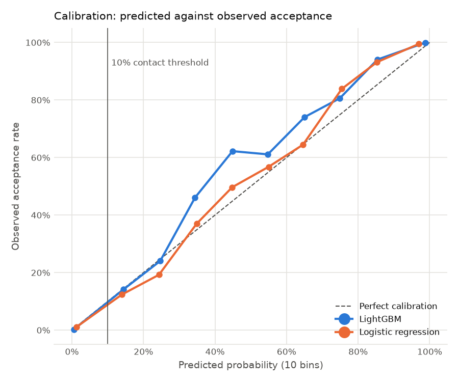
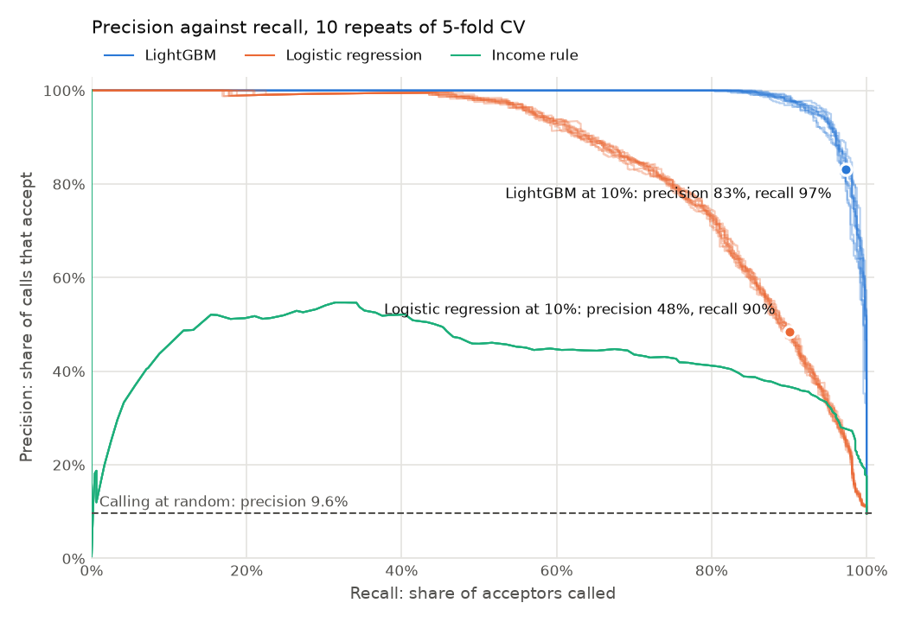
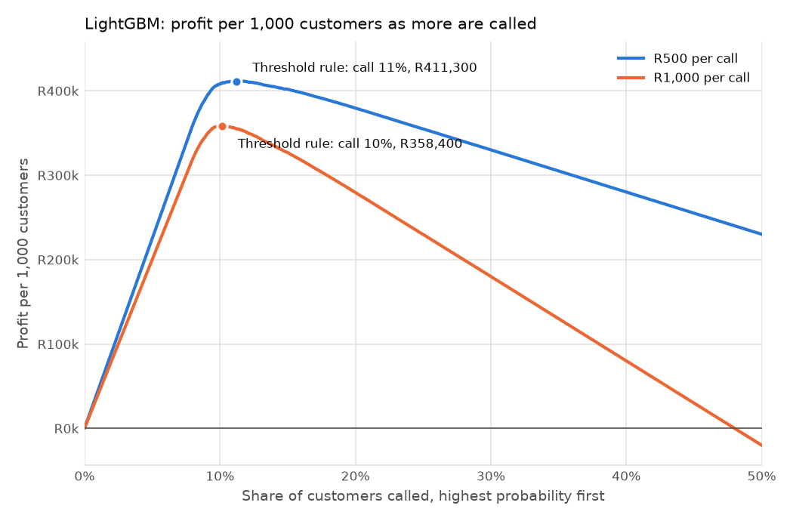

# Which customers to call about a personal loan

**To:** Naledi Mokoena, Head of Personal Lending, Karoo Bank
**Date:** 28 October 2026

Karoo Bank is fictional. The figures come from the public Thera Bank personal loan dataset (5,000 customers), relabelled for this memo.

## Decision

Which customers should Karoo Bank call about a personal loan offer, and what is that worth per 1,000 customers?

## Answer

Call the customers whose model-estimated chance of accepting is 10% or higher. That is about 112 of every 1,000 customers.

- **Expected profit:** R411,000 per 1,000 customers. This is 95% of the R432,000 that perfect foresight would earn.
- **Compared with simpler rules:** calling everyone with an income of about 97 ($000s) or more earns R315,000. Calling everyone loses R20,000.
- **If a call costs R1,000 instead of R500:** raise the threshold to 20%. The bank then calls about 102 per 1,000 and earns R358,000.

The 10% threshold is not tuned. It is the break-even point of the stated costs: a call costs R500, and an accepted loan earns R5,000.

## Baseline

Each call costs R500, and each accepted loan earns R5,000 in margin. Both figures are assumptions. At those figures, a call pays for itself when the customer's chance of accepting is at least 10% (R500 / R5,000).

In the data, 9.6% of customers accepted the offer, so a model that predicts "no" for everyone is 90.4% accurate. This is why accuracy is not used to judge the models.

Every rule below is priced the same way. In a typical group of 1,000 customers, 96 would accept the offer:

```
profit = acceptors reached × R5,000 − calls made × R500
```

| Rule | Calls per 1,000 | Acceptors reached (of 96) | Margin earned | Cost of calls | Profit per 1,000 |
| --- | --- | --- | --- | --- | --- |
| Call nobody | 0 | 0 | R0 | R0 | R0 |
| Call everyone | 1,000 | 96 | R480,000 | R500,000 | -R20,000 |
| Call everyone above an income cutoff | 259.1 | 89.0 | R444,900 | R129,560 | R315,340 |
| Perfect foresight | 96 | 96 | R480,000 | R48,000 | R432,000 |

What each row shows:

- **Call nobody** earns nothing and spends nothing. Every other rule is measured against it.
- **Call everyone** loses money because fewer than 1 in 10 customers accept. A call needs a 1-in-10 chance of acceptance to cover its R500 cost, so 1,000 calls cost R20,000 more than the 96 loans earn.
- **The income cutoff** calls only customers who earn about 97 ($000s) or more. It reaches 89 of the 96 acceptors with about a quarter of the calls, because almost all acceptors are high earners. It still makes 170 calls that do not convert.
- **Perfect foresight** calls only the 96 customers who accept, so every call converts. No rule can earn more, so this is the ceiling the models are measured against.

The income-cutoff figures are averages over the 50 cross-validation folds described in the [Method](#method) section, so they are not whole numbers in every fold.

Every customer in the data received the offer, so there is no control group. The data cannot show who would have borrowed without a call. The profit figures assume that a customer who is not called does not borrow. The [Sensitivity](#sensitivity) section relaxes this assumption.

## Method

**Data.** 5,000 customers, 480 of whom accepted. The code checks the file's SHA-256 checksum, row count, columns and acceptance count on every load. Three columns are dropped before modelling, each for a reason that does not use the outcome:

- `ID`: a row identifier.
- `ZIP Code`: a code with 467 values and one broken entry.
- `Experience`: equal to `Age` minus 24 to 30 years for every customer (correlation 0.994), with 52 impossible negative values.

The remaining 10 inputs are age, income, monthly card spend, mortgage, family size, education, and four product flags (securities account, CD account, online banking, credit card). No new features were created.

**Models.** Two models estimate each customer's chance of accepting:

- Logistic regression, with standardised numeric inputs and one-hot encoded family size and education.
- LightGBM, a gradient-boosted tree model, on the raw inputs.

Both models are calibrated with Platt scaling, so that a predicted 10% means about 1 in 10 such customers accept. The income-cutoff rule picks its cutoff on profit in each training fold, so it is judged the same way as the models.

**Tuning.** One separate 5-fold run, on its own random seed, chose each model's settings by log loss: 5 penalty values for logistic regression and 20 random LightGBM configurations. The settings were then frozen.

**Evaluation.** 5-fold stratified cross-validation, repeated 10 times: 50 train-and-test splits. Every step that learns from data (scaling, encoding, the model, calibration and the income cutoff) is fitted on the training part only. Each rule is scored on the held-out part by profit per 1,000 customers. The model with the highest mean profit at the 10% threshold is recommended.

The calibration chart shows that predicted probabilities match observed acceptance near the 10% threshold, where the decision is made. Bins between 30% and 60% hold only 13 to 17 customers per repeat, so their departures from the diagonal are mostly noise. They do not affect the decision, because everyone above 10% is called.



## Results

The figures below are averages over 50 held-out folds, at R500 per call. Each rule is priced with the same formula as the baseline: acceptors reached × R5,000 − calls made × R500.

**Where the profit comes from**

| Rule | Calls per 1,000 | Acceptors reached (of 96) | Margin earned | Cost of calls | Profit per 1,000 |
| --- | --- | --- | --- | --- | --- |
| **LightGBM** | 112.4 | 93.4 | R467,200 | R56,180 | **R411,020** |
| Logistic regression | 178.7 | 86.5 | R432,300 | R89,330 | R342,970 |
| Income cutoff | 259.1 | 89.0 | R444,900 | R129,560 | R315,340 |
| Perfect foresight | 96.0 | 96.0 | R480,000 | R48,000 | R432,000 |

Calls and acceptors are rounded to one decimal place. The margin and cost columns use the unrounded averages.

- **LightGBM** reaches 93.4 of the 96 acceptors and makes only 19 calls that do not convert. Its shortfall from the ceiling is R20,980: the 2.6 acceptors it misses cost R12,800 in margin, and its 16.4 extra calls cost R8,180.
- **Logistic regression** misses 9.5 acceptors and makes 92 calls that do not convert, so it earns less margin and spends more on calls.
- **The income cutoff** reaches more acceptors than logistic regression (89.0 against 86.5), but it needs 259 calls to do so. Its call costs are more than double LightGBM's.

**How consistent and accurate each rule is**

| Rule | Spread (SD) | Share of ceiling | Precision | Recall |
| --- | --- | --- | --- | --- |
| **LightGBM** | R6,713 | **95%** | 83% | 97% |
| Logistic regression | R12,282 | 79% | 48% | 90% |
| Income cutoff | R9,033 | 73% | 34% | 93% |
| Perfect foresight | R0 | 100% | 100% | 100% |

- *Spread* is the standard deviation of profit across the 50 folds. A smaller spread means a more predictable result.
- *Share of ceiling* is profit divided by the R432,000 that perfect foresight earns.
- *Precision* is acceptors reached divided by calls made: the share of calls that convert.
- *Recall* is acceptors reached divided by 96: the share of all acceptors who are called.

LightGBM earned more than each alternative in all 50 folds. Within each fold, it beat logistic regression by R68,050 per 1,000 on average and the income cutoff by R95,680.

The gain over the income cutoff is large, not marginal. A one-line income rule still captures 73% of the possible profit, so it is a reasonable fallback if a model cannot be deployed.

Logistic regression trails LightGBM partly because it cannot represent a threshold. In this data, nobody with an income below 60 ($000s) accepted, and a linear model cannot draw that line.



## Sensitivity

**Contact cost and would-borrow-anyway.** Each scenario changes one input to the profit formula. The threshold is always the cost of a call divided by the margin it can earn, so it moves with the inputs.

| Scenario | Margin per acceptor reached | Cost per call | Threshold |
| --- | --- | --- | --- |
| Base | R5,000 | R500 | R500 / R5,000 = 10% |
| R1,000 per call | R5,000 | R1,000 | R1,000 / R5,000 = 20% |
| 25% of acceptors would borrow anyway | R3,750 | R500 | R500 / R3,750 = 13.3% |
| 50% of acceptors would borrow anyway | R2,500 | R500 | R500 / R2,500 = 20% |

If a share of acceptors would have borrowed without a call, the call only earns margin on the rest. At 25%, a call earns 75% of R5,000, which is R3,750 per acceptor reached.

The recommendation holds in every scenario. LightGBM stays first:

| Scenario | LightGBM | Logistic regression | Income cutoff | Ceiling |
| --- | --- | --- | --- | --- |
| Base | R411,020 | R342,970 | R315,340 | R432,000 |
| R1,000 per call | R358,000 | R275,820 | R194,940 | R384,000 |
| 25% would borrow anyway | R294,600 | R238,095 | R206,880 | R312,000 |
| 50% would borrow anyway | R179,000 | R137,910 | R97,470 | R192,000 |

The ceiling is 96 acceptors × (margin per acceptor − cost per call). For example, at R1,000 per call: 96 × (R5,000 − R1,000) = R384,000.

Where LightGBM's profit comes from in each scenario:

| Scenario | Calls per 1,000 | Acceptors reached (of 96) | Margin earned | Cost of calls | Profit per 1,000 |
| --- | --- | --- | --- | --- | --- |
| Base | 112.4 | 93.4 | R467,200 | R56,180 | R411,020 |
| R1,000 per call | 101.5 | 91.9 | R459,500 | R101,500 | R358,000 |
| 25% would borrow anyway | 108.0 | 93.0 | R348,600 | R54,000 | R294,600 |
| 50% would borrow anyway | 101.5 | 91.9 | R229,750 | R50,750 | R179,000 |

- **A higher call cost** raises the threshold, so LightGBM calls about 11 fewer customers per 1,000 and misses 1.5 more acceptors. The income cutoff falls the most, because its 202 calls now cost R201,660.
- **Would-borrow-anyway** makes each acceptor reached worth less, so the threshold rises and fewer customers are worth calling. The ceiling falls too: even a perfect call earns only the margin on loans the call causes.

R500 per call is the input most open to challenge. If the true cost is higher, the threshold rises, but targeting still earns R358,000 per 1,000 at double the cost. Higher costs hurt the income cutoff most, because it calls the most people.

The would-borrow-anyway rows assume that the same share applies to every customer. In practice, the customers most likely to accept may also be the most likely to borrow without a call, so these rows flatter targeting.

**CD Account.** Customers with a certificate of deposit accepted at 46%, against 7% for others. The data does not record when each account was opened, so some CD accounts might have been opened with the loan. In that case, the feature would leak the outcome. Without CD Account, LightGBM earns R408,020 per 1,000, R3,000 less. The recommendation does not depend on this feature.

**The threshold.** The chart ranks customers by LightGBM's estimate and adds them one at a time. The 10% threshold lands within R300 per 1,000 of the best possible cut-off, at both R500 and R1,000 per call. At R1,000 per call, calling half of all customers would lose money.



## Limitations

- **No control group.** The data cannot show who would have borrowed without a call, so the profit figures may overstate what calls cause. A randomised hold-out group in the next campaign would measure this directly.
- **The economics are assumptions.** R500 per call and R5,000 per loan are illustrative. The Sensitivity section shows how the answer changes with them.
- **The data looks partly generated.** `Experience` was derived from `Age`, and incomes and card spend fall on a regular grid. Patterns in real data, especially the sharp income threshold, are likely to be less clean.
- **CD Account timing is unknown.** Its effect on profit is measured (R3,000 per 1,000) but not resolved.
- **Spreads are understated.** The 10 repeats reuse the same 5,000 customers, so the 50 folds are not independent. The gaps between rules are large enough that this does not change the ranking.
- **Tuning used the same customers.** It ran on a separate split, and most LightGBM configurations scored within 0.003 log loss of each other, so the choice carries little optimism.

**Next steps.** Test three features built from lending logic, given to both models: income per household member, card spend as a share of income, and whether the customer has a mortgage.

## Reproduce

You need [uv](https://docs.astral.sh/uv/getting-started/installation/). uv installs Python 3.11 and the locked dependency versions for you.

1. Clone the repository and go to the project folder:

   ```bash
   git clone https://github.com/BaasKoebies/DSProjects.git
   cd "DSProjects/Portfolio/Project 1 - Personal Loans"
   ```

1. Create the environment from `uv.lock`:

   ```bash
   uv sync
   ```

1. Run the tests:

   ```bash
   uv run pytest
   ```

   All tests pass. If `test_csv_fingerprint_matches` fails on Windows, check that the `.gitattributes` file is present in the project folder, then check out the CSV again.

1. Optional: run the exploratory analysis. It prints the data profile and saves the EDA charts to `figures/`.

   ```bash
   uv run python -m loan_targeting.eda
   ```

1. Rerun the analysis. The results are already committed in `results/`, so this step is only needed to check them.

   ```bash
   uv run python -m loan_targeting.tune
   uv run python -m loan_targeting.evaluate
   uv run python -m loan_targeting.report
   ```

   Tuning takes about 2 minutes and evaluation about 3 minutes. The scripts overwrite `results/` and the memo charts in `figures/` with identical files.
